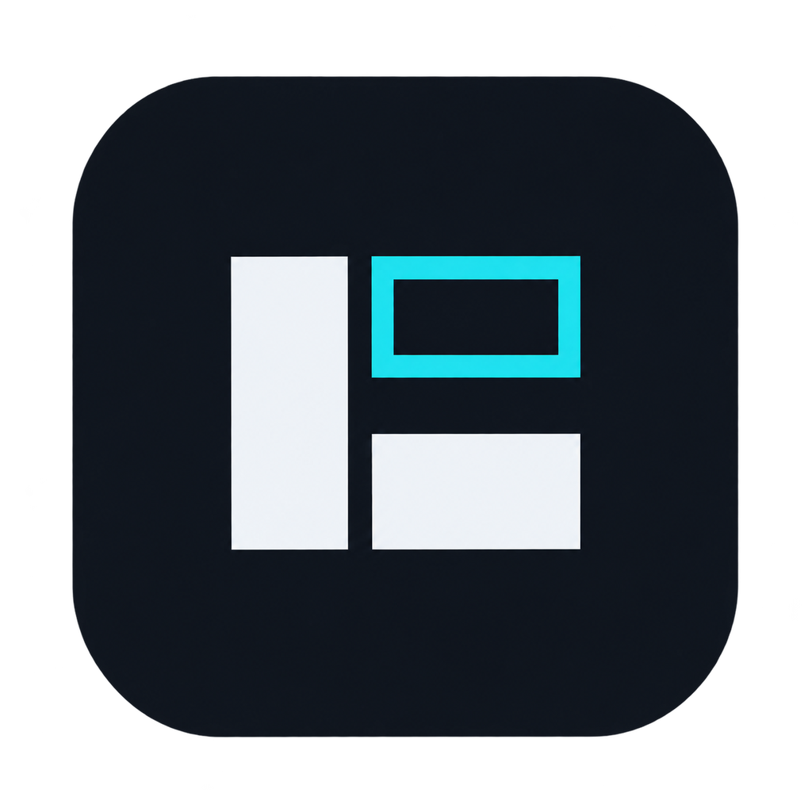
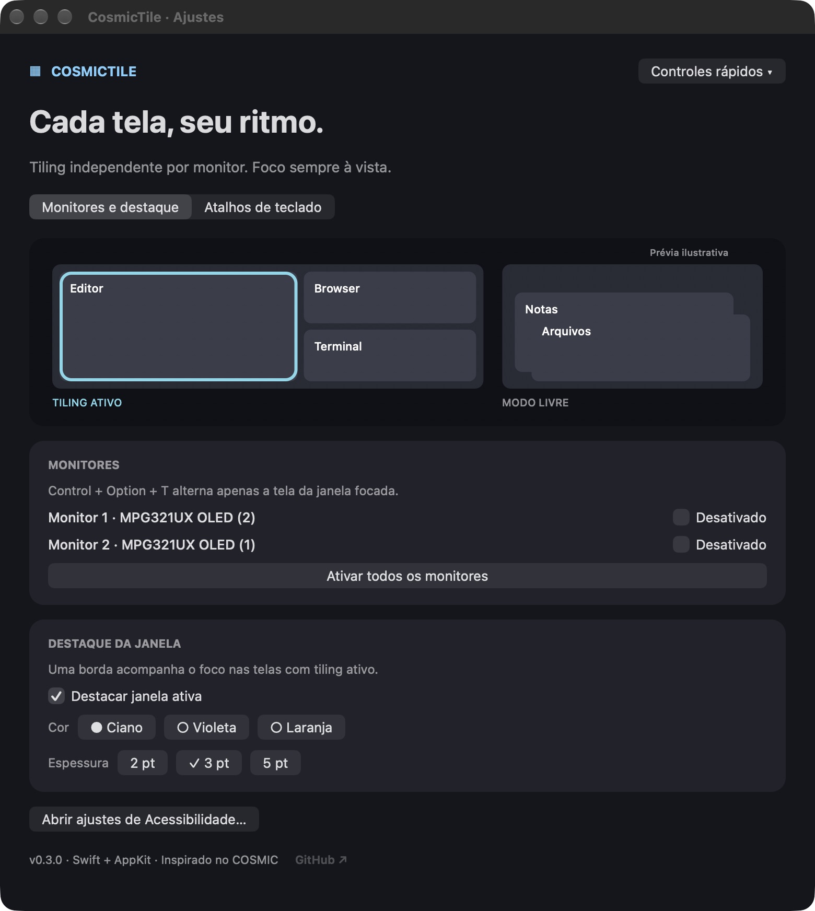
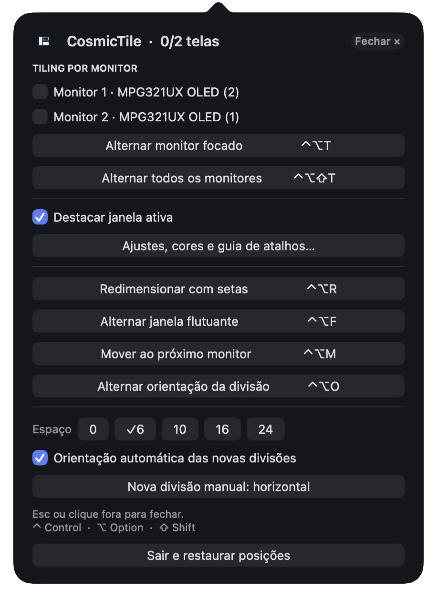
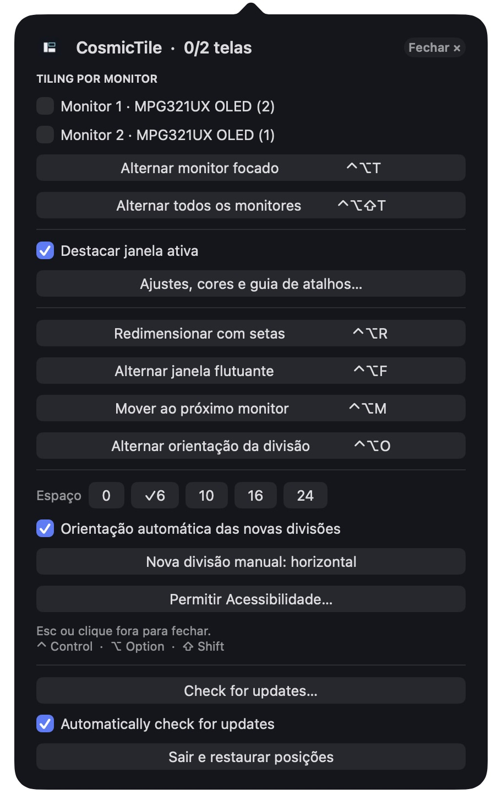
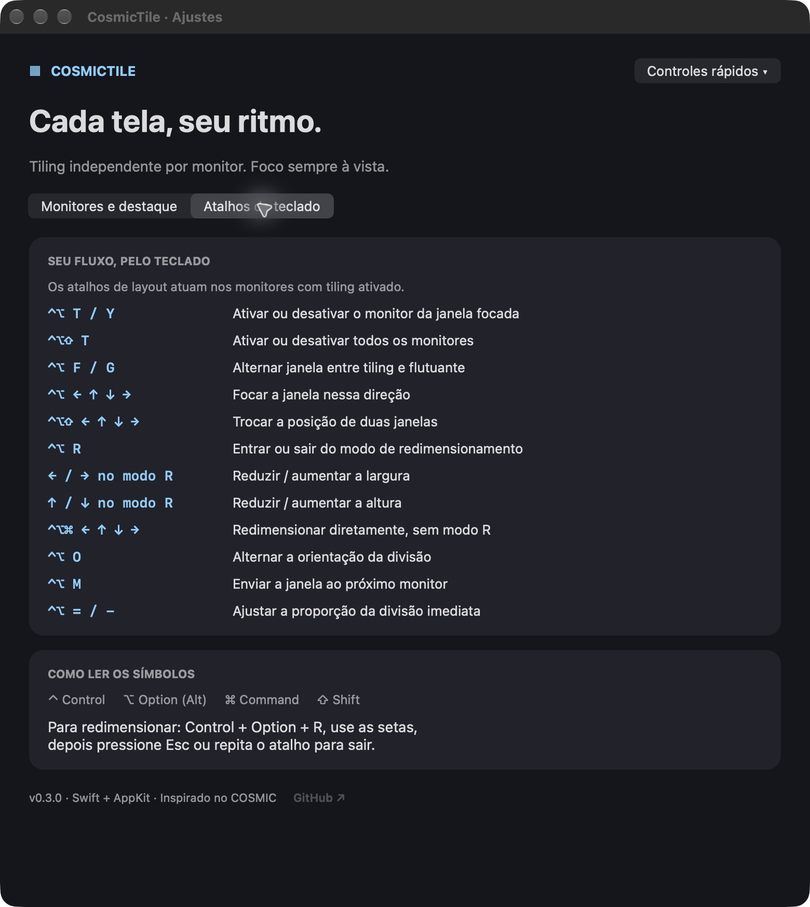

<div align="center">



# CosmicTile for macOS

**Cada tela, seu ritmo.**

A native Swift window manager for macOS, inspired by COSMIC.<br>
Independent tiling per monitor · Active-window highlight · Keyboard resizing

[Official website](https://cosmictile.app.amazing-ai.tools) · [Download for Apple Silicon](https://cosmictile.app.amazing-ai.tools/#download) · [Português](docs/README.pt-BR.md) · [Keyboard shortcuts](#keyboard-shortcuts) · [Report a bug](https://github.com/hckmseduardo/MacCosmicTile/issues/new?template=bug_report.md)

</div>



> **Early preview.** This is an independent project, not affiliated with System76. The screenshot shows the actual native settings window; its small layout preview is illustrative, not a capture of managed application windows.

## What it does

| Feature | How it works |
| --- | --- |
| **A different workflow on each screen** | Enable tiling on one monitor and leave another floating. Each display has its own layout tree and on/off switch. |
| **A visible focus** | A click-through border follows the active managed window. Choose cyan, violet or orange, and a 2, 3 or 5 pt stroke. |
| **Automatic placement** | New windows split available space horizontally or vertically. A crowded focused tile gives way to a larger region. |
| **Keyboard control** | Focus, swap, resize, rotate a split, float a window, or send it to another monitor. |
| **A lightweight native app** | Swift + AppKit, a menu bar icon, and no third-party package dependencies. |
| **Best-effort restoration** | Disabling a monitor restores its managed windows without switching off the other displays. Normal quit restores all managed displays. |

## Install

### Download the app

1. Open [Releases](https://github.com/hckmseduardo/MacCosmicTile/releases) and download the **macOS arm64** ZIP.
2. Extract it and move `CosmicTile.app` into **Applications**.
3. Open the app. Look for **▦** in the menu bar. Tiling starts **off**.
4. Open **Ajustes, cores e guia de atalhos…** and grant Accessibility access as described below.

The published bundle is **locally ad-hoc signed, not Developer ID signed or notarized**. macOS may prevent the first launch. Review the source/build provenance and, if you choose to proceed, use **System Settings → Privacy & Security → Open Anyway**. The project does not require disabling Gatekeeper or SIP.

**Requirements:** macOS 14 or later. The downloadable build targets **Apple Silicon (arm64)**. Intel hardware has not been validated; build from source on Intel if you want to experiment. Compatibility with every macOS version and application is not established.

### Build from source

Install Xcode 26 or later, or a Swift 6.2-compatible toolchain:

```sh
git clone https://github.com/hckmseduardo/MacCosmicTile.git
cd MacCosmicTile
swift test
./build-app.sh
open dist/CosmicTile.app
```

Open `Package.swift` in Xcode to develop. To change the app output directory:

```sh
COSMICTILE_BUILD_DIR=/path/to/output ./build-app.sh
```

## First launch: Accessibility

CosmicTile uses the macOS **Accessibility API** to read and adjust window positions and sizes. It does not replace the compositor or use private APIs to control Spaces.

1. Open **System Settings → Privacy & Security → Accessibility**.
2. Enable **CosmicTile**, adding the app with **+** if it is missing.
3. Quit and reopen CosmicTile if the permission is not recognized.
4. Enable tiling for the monitor you want to use.

Keep the app in one stable location. Rebuilding or replacing a locally signed app can invalidate its Accessibility approval. If an update no longer moves windows, remove the outdated entry and add the current app again.

## Everyday use

### Open at login

In **Ajustes → Geral**, turn on **Abrir ao iniciar sessão** to open CosmicTile in the menu bar when you sign in. If macOS asks for approval, use **Abrir Itens de Início…** to approve it in System Settings. Turn off the same option to stop opening CosmicTile at login.

### Choose which monitors tile

Click **▦** to open the quick controls. Switch individual monitors on/off by name, or open the settings window for the same switches. The status icon shows the number of active displays, for example **▦ 1/2**.

- **Control + Option + T** toggles only the monitor containing the focused window.
- If no focused window is available, the monitor under the pointer is used.
- **Control + Option + Shift + T** enables all connected monitors, or disables all when every monitor is already enabled.
- Newly connected monitors start with tiling off. An already-active display stays active when another is disconnected.
- Sending a window to a monitor with tiling off leaves it floating there.

Quick controls close with **Escape**, the **Fechar ×** button, a click outside, or another click on the status icon. Window commands preserve the window selected before opening the panel.



### Highlight the focused window

Open **Ajustes, cores e guia de atalhos… → Monitores e destaque**:

- Toggle **Destacar janela ativa**.
- Choose **Ciano**, **Violeta** or **Laranja**.
- Choose **2**, **3** or **5 pt** thickness.

The transparent border follows the focused tiled/floating managed window on a tiling-enabled monitor. It does not take keyboard focus or intercept clicks. It hides for unmanaged windows, disabled displays, or when tiling is off. Color, width, enabled state and gap size persist between launches.

### Save and open dialogs stay floating

Save/Open panels, modal dialogs, attached sheets, floating utility windows and nonresizable auxiliary windows are excluded from tiling. Eligibility uses Accessibility role, subrole, modal state and resize capability, rather than localized window titles. Main document windows remain tiled. Applications with incorrect Accessibility metadata can still require manual floating.

### Resize a window

1. Focus the window.
2. Press **Control + Option + R**.
3. Use **← / →** to reduce/increase width, and **↑ / ↓** to reduce/increase height.
4. Press **Escape**, **Return**, or **Control + Option + R** to exit.

While resize mode is active, unmodified arrow keys are temporarily captured. They are released when the mode ends. You can also resize directly with **Control + Option + Command + arrows**. Neighboring tiles adjust together; an axis has no effect if the layout has no matching ancestor split.

## Updates from GitHub



Use **Check for updates…** in the quick controls. Automatic checks run at startup and at most daily; use **Automatically check for updates** to turn them off. Compatible preview releases are included.

A new version shows its release notes and download size. Choose **Install and Restart** to approve the update. CosmicTile verifies and extracts the download, replaces the app at its current location and reopens. If the new version fails to start, CosmicTile restores the previous version. **Later** defers the update and **Release notes** opens GitHub.

Updating from v0.4.1 or earlier requires [one final manual installation](#install). See [update behavior and trust policy](docs/UPDATES.md).

## Keyboard shortcuts

`⌃` = **Control** · `⌥` = **Option / Alt** · `⌘` = **Command** · `⇧` = **Shift**.

| Shortcut | Action |
| --- | --- |
| `⌃⌥T` or `⌃⌥Y` | Toggle tiling on the focused monitor |
| `⌃⌥⇧T` | Toggle tiling on all monitors |
| `⌃⌥F` or `⌃⌥G` | Toggle focused window floating |
| `⌃⌥← ↑ ↓ →` | Focus a window in that direction |
| `⌃⌥⇧← ↑ ↓ →` | Swap with a window in that direction |
| `⌃⌥R` | Enter/exit resize mode |
| `← / →` in resize mode | Reduce/increase width |
| `↑ / ↓` in resize mode | Reduce/increase height |
| `Esc` / `Return` in resize mode | Exit resize mode |
| `⌃⌥⌘← ↑ ↓ →` | Resize directly without entering resize mode |
| `⌃⌥O` | Rotate the focused window's immediate split |
| `⌃⌥M` | Move the focused window to the next monitor |
| `⌃⌥= / -` | Adjust the immediate split proportion |

The settings window includes a native shortcut guide:



## Troubleshooting

| Symptom | What to check |
| --- | --- |
| Nothing moves | Confirm Accessibility permission for the current app bundle, then enable that monitor. |
| It worked before an update | Re-add the app's Accessibility entry and reopen it. |
| The second monitor stays floating | Check its individual toggle. New displays are deliberately off by default. |
| Windows overlap | Some applications impose minimum sizes. Try fewer windows, reduce gaps, rotate the split, or float the affected window. This preview does not yet solve arbitrary minimum-size constraints. |
| A shortcut does nothing | Confirm tiling is on for the focused monitor and check conflicts with system/other-app shortcuts. |
| Arrow keys are resizing instead of typing | Exit resize mode with Escape or Control + Option + R. |
| The outline is missing | Enable the active hint and focus a managed window on an enabled monitor; it intentionally hides elsewhere. |
| A popup stays open | Use Escape or **Fechar ×**. v0.3 replaces the old blocking native menu with transient quick controls. |

A command-line diagnostic is available:

```sh
dist/CosmicTile.app/Contents/MacOS/CosmicTile --diagnose
```

A diagnostic launched from a terminal may have a different Accessibility permission context from the app launched through Finder; the settings window reflects the running app's actual access.

## Scope and known limitations

- No tabbed stacks, ancestor-group selection, drag target previews, persistent application rules, or independent workspace system yet.
- Only standard visible windows in the current macOS Space are considered; no per-Space layout persistence.
- Reconciliation is polled at roughly 350 ms; the focus hint updates on a separate 120 ms tick. Frame application pauses during mouse dragging and does not run unconditionally on every tick.
- Manual mouse resizing does not update stored split ratios.
- Placement uses a 480 × 300 pt heuristic. Application-specific minimum sizes can still cause overlap or refused adjustments.
- Secondary display geometry reserves the primary menu-bar inset when `visibleFrame` incorrectly reports the entire secondary screen as usable. More display/auto-hide arrangements need live testing.
- Layouts, monitor activation and floating state are session-only. Newly launched apps start with all monitors disabled.
- Restoration is best effort after display changes. Forced termination or a crash cannot guarantee restoration.
- The app interface is currently Portuguese. The English README describes the same controls.

## Development and validation

The project has **36 unit tests** for placement, insertion, split geometry, negative coordinates, swaps, resizing, rotation, independent monitor state, display removal, restoration clamping and outline coordinate conversion. The native settings and shortcut views were inspected and captured on macOS. App-specific Accessibility behavior and full multi-monitor operation still require real-world validation; unit tests are not a substitute for it.

| Source | Responsibility |
| --- | --- |
| `Sources/TileCore/Layout.swift` | Layout tree and transformations |
| `Sources/TileCore/Placement.swift` | Focus-aware placement heuristics |
| `Sources/TileCore/MonitorTiling.swift` | Per-monitor activation and display geometry |
| `Sources/CosmicTile/Accessibility.swift` | Window discovery and AX operations |
| `Sources/CosmicTile/Controller.swift` | Reconciliation, commands and restoration |
| `Sources/CosmicTile/FocusIndicator.swift` | Click-through active-window outline |
| `Sources/CosmicTile/QuickControls.swift` | Transient status-panel controls |
| `Sources/CosmicTile/Preferences.swift` | Native settings, preview and shortcut guide |
| `Sources/CosmicTile/Hotkeys.swift` | Global and temporary mode hotkeys |

See [CHANGELOG.md](CHANGELOG.md), [CONTRIBUTING.md](CONTRIBUTING.md), [release verification](docs/VALIDATION.md), and [roadmap](docs/ROADMAP.md). The Windows counterpart is [WindowsCosmiTile](https://github.com/hckmseduardo/WindowsCosmiTile).

## Shared identity

CosmicTile uses the same application artwork on macOS and Windows. The macOS menu bar uses an OS-tinted template rendition; Windows embeds the color icon in the executable and notification-area icon. See the [brand guide](assets/brand/BRAND.md) and [identity board](assets/brand/brand-board.png).

## Keep awake

Toggle **Keep awake** in the menu to keep the display and computer awake while CosmicTile is running. It starts off each launch. Disable it or quit to release the native power request. Manual locking remains available. Screen-saver locks and organization-enforced inactivity locks may still apply; this option does not change security or power settings permanently.
