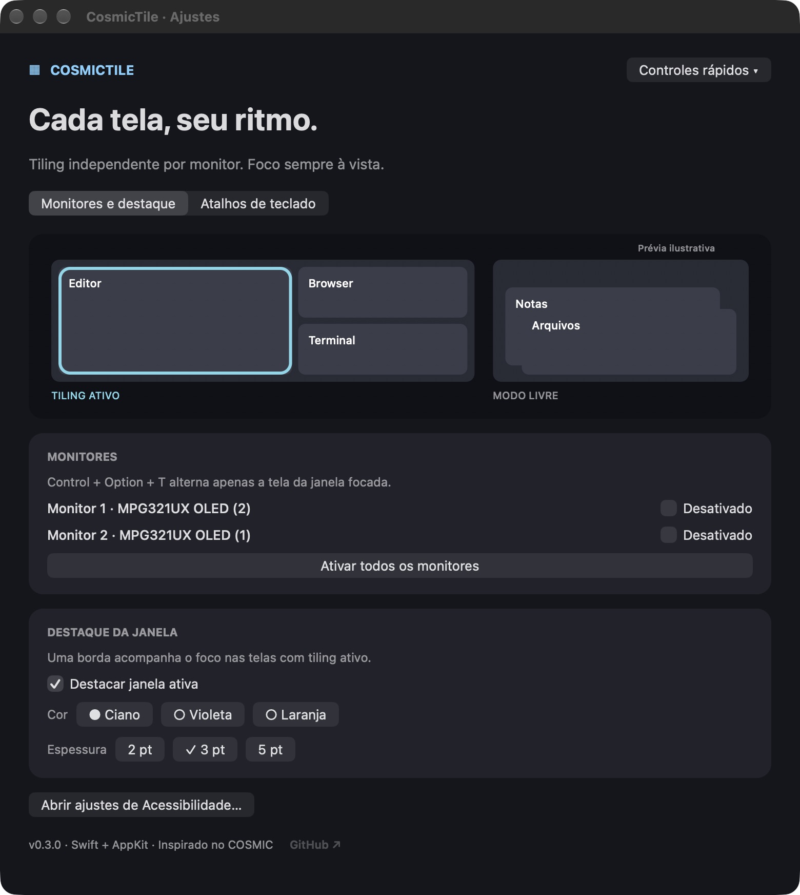
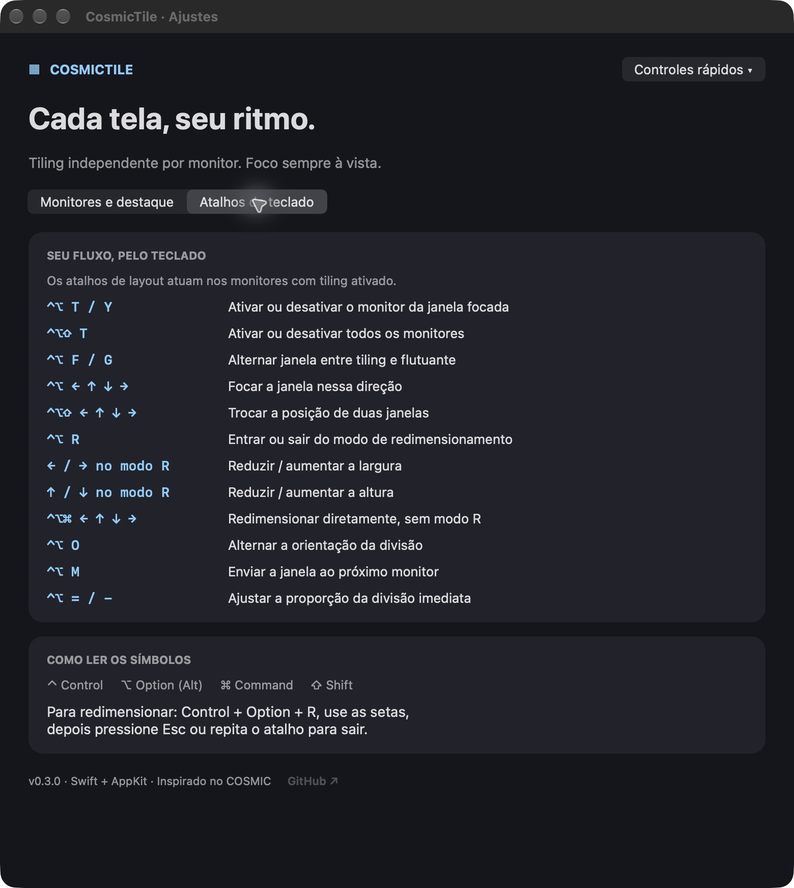

# MacCosmicTile — guia em português

Gerenciador de janelas nativo em Swift, inspirado no COSMIC, com tiling independente por monitor e borda de foco.

[Baixar para Mac Apple Silicon](https://github.com/hckmseduardo/MacCosmicTile/releases/latest) · [README completo](../README.md)



A pequena prévia de layout dentro dos ajustes é ilustrativa. As screenshots mostram a interface real do app, sem capturar conteúdo de janelas pessoais.

## Instalação

1. Baixe o ZIP **macOS arm64** na página de releases.
2. Extraia e mova `CosmicTile.app` para **Aplicativos**.
3. Abra o app e procure **▦** na barra de menus.
4. Em **Ajustes do Sistema → Privacidade e Segurança → Acessibilidade**, permita o CosmicTile.
5. No painel do app ou nos ajustes, ative apenas os monitores desejados.

A build é assinada localmente, sem notarização Apple. O macOS pode exigir **Abrir Mesmo Assim**, em Privacidade e Segurança, na primeira execução. Não é necessário desativar Gatekeeper nem SIP. Após uma atualização, pode ser necessário remover e adicionar novamente a autorização de Acessibilidade.

## Monitores independentes

**Control + Option + T** alterna o monitor da janela focada; sem uma janela disponível, usa a tela sob o ponteiro. **Control + Option + Shift + T** alterna todos. Desativar um monitor restaura as posições das janelas dele e mantém os outros como estavam. Novos monitores iniciam desativados.

O painel fecha com **Esc**, clique fora, **Fechar ×** ou outro clique no ícone da barra.

## Destaque e aparência

Abra **Ajustes, cores e guia de atalhos…** para ativar a borda da janela focada, escolher cor e espessura. A borda não recebe cliques nem rouba foco. Ela aparece apenas em janelas gerenciadas, nas telas com tiling ativo. Espaçamento e orientação das novas divisões ficam no painel rápido.

## Atalhos

| Combinação | Ação |
| --- | --- |
| Control + Option + T / Y | Alternar monitor focado |
| Control + Option + Shift + T | Alternar todos os monitores |
| Control + Option + F / G | Alternar janela flutuante |
| Control + Option + setas | Mudar foco |
| Control + Option + Shift + setas | Trocar janelas de posição |
| Control + Option + R | Entrar/sair do redimensionamento |
| Setas no modo R | Esquerda/direita: reduzir/aumentar largura; cima/baixo: reduzir/aumentar altura |
| Esc / Enter no modo R | Sair do redimensionamento |
| Control + Option + Command + setas | Redimensionar diretamente |
| Control + Option + O | Girar orientação da divisão |
| Control + Option + M | Mover ao próximo monitor |



## Compilar

Requer Swift 6.2 / Xcode 26 ou posterior. No diretório do repositório:

```sh
swift test
./build-app.sh
open dist/CosmicTile.app
```

## Estado atual

Versão inicial: ainda não tem pilhas com abas, arraste com prévia, regras por aplicativo nem layouts persistentes por Space. Aplicativos podem impor tamanhos mínimos e recusar ajustes; por isso, sobreposição em cenários apertados ainda é possível. Há 27 testes automatizados do motor e geometria. A interface foi inspecionada em execução, mas o comportamento com todos os aplicativos e combinações de monitores ainda precisa de validação.
